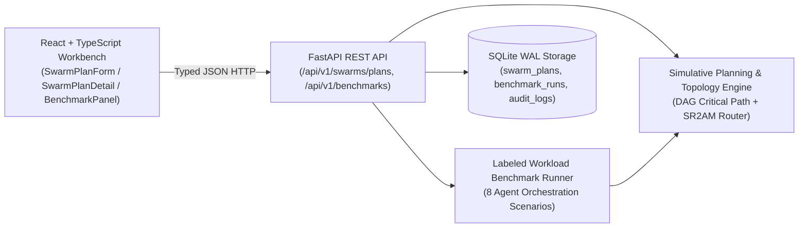

# Atlas Observatory (`atlas-observatory-ryan-vo`) — Ryan Vo | AI & Machine Learning

> Work in progress. This checkpoint may be incomplete or fail tests. See PLAN.md and STATUS.md before use.


Atlas Observatory is an AI/ML developer workbench for multi-agent swarm orchestration engineers and researchers who need to eliminate wasteful reasoning-token expenditure on flat agent routing. It implements a deterministic Directed Acyclic Graph (DAG) critical-path horizon analyzer and a selective Simulative Planning Router (`SR²AM`) that decides when a multi-agent workflow warrants a forward world-model shadow pass versus direct reactive execution, alongside topological communication-overhead analysis across `hierarchical`, `mesh`, `ring`, and `star` agent swarms.

> **Incremental Checkpoint Notice (`v1.0.0`):** This repository is developed incrementally. Round 1 delivers the `simulative-swarm-planner` workflow end-to-end (FastAPI + SQLite + React/TypeScript workbench + reproducible benchmark suite). Remaining roadmap capabilities (`witness-manifest-verifier`, `goap-action-planner`, `quantized-memory-benchmark`, `oidc-keycloak-rbac`, and `advisory-llm-adapters`) are tracked as `planned` in [`feature-plan.json`](feature-plan.json), [`PLAN.md`](PLAN.md), and [`STATUS.md`](STATUS.md).

---

## Architecture



---

## Implemented Features (`simulative-swarm-planner`)

1. **DAG Critical-Path & Horizon Analyzer (`backend/app/services/planner_engine.py`)**:
   - Validates subtask dependency graphs using Kahn's topological sort, rejecting duplicate node IDs, unknown dependencies, self-dependencies, and cycles with `HTTP 422`.
   - Computes earliest/latest start and finish windows to identify the exact critical path (`on_critical_path`) and critical-path step horizon.
2. **Selective Simulative Planning Router (`SR²AM` Depth Allocation)**:
   - Evaluates whether a workflow's critical-path horizon exceeds `horizon_threshold` (default `5` steps) or its aggregate tool density meets `mcp_call_threshold` (default `2` MCP calls).
   - Routes complex multi-step workflows to `simulative_forward_pass` (allocating a compact `256`-token shadow planning pass that compresses downstream exploration and tool retry overhead) and shallow tasks to `reactive_direct`.
3. **Swarm Topology & Bottleneck Evaluator**:
   - Computes active agent allocation, communication link counts, coordination latency, parallel speedup, and parallel efficiency across `hierarchical`, `mesh`, `ring`, and `star` topologies.
   - Emits actionable bottleneck warnings when quadratic peer links (`mesh` with $\ge 8$ agents), hub serialization (`star`), or purely sequential dependency chains degrade parallel efficiency.
4. **Persistent SQLite Storage, JSON Export & Audit Trail (`backend/app/services/swarm_repository.py`)**:
   - Persists evaluated swarm plans, benchmark runs, and mutation audit logs in SQLite.
   - Supports filtering by topology, routing mode, and text search, plus portable JSON bundle export.

## Planned Roadmap Milestones

See [`PLAN.md`](PLAN.md) and [`feature-plan.json`](feature-plan.json) for full acceptance criteria:
- `witness-manifest-verifier` (`planned`): Platform build manifest (`macos`, `linux`, `windows`) SHA-256 and Ed25519 witness verification that fails explicitly when `dist/` artifacts are absent.
- `goap-action-planner` (`planned`): Deterministic A* Goal-Oriented Action Planning over world-state preconditions and effects.
- `quantized-memory-benchmark` (`planned`): Recall vs memory footprint evaluation for `float32`, `int8`, and 1-bit `RaBitQ` vector quantization.
- `oidc-keycloak-rbac` (`planned`): OIDC Authorization Code + PKCE authentication, Keycloak SAML identity brokering, and role-based access control.
- `advisory-llm-adapters` (`planned`): Opt-in server-side `LLM_API_KEY` adapters for OpenAI-compatible, Anthropic Messages, and Gemini `generateContent` endpoints.

---

## AI/ML Evaluation

Atlas Observatory includes a deterministic, reproducible evaluation harness (`backend/app/services/benchmark_service.py`) that benchmarks selective simulative routing against a flat Tier-3 routing baseline across 8 labeled multi-agent workloads.

### Reproducible Command

```bash
PYTHONPATH=backend .venv/bin/python -c "from app.services.benchmark_service import run_labeled_benchmark_suite; print(run_labeled_benchmark_suite().model_dump_json(indent=2))"
```

### Data Provenance & Baseline

- **Dataset**: 8 curated, synthetic multi-agent DAG workloads defined in `BENCHMARK_WORKLOADS` (`backend/app/services/benchmark_service.py`), spanning 3 shallow reactive workloads (`gaia-single-hop-status`, `syntax-lint-autofix`, `unit-assertion-check`) and 5 deep or tool-intensive swarm workloads (`sr2am-multi-hop-rag`, `witness-cross-platform-audit`, `swarm-v3-orchestrator-split`, `rabitq-quantization-migration`, `mcp-federation-breaker`).
- **Baseline**: Flat Tier-3 dispatch where every subtask executes an unguided deep reasoning pass with step-horizon expansion (`+18%` per step beyond 1, `+6%` per DAG depth level) and unpruned MCP tool schema overhead (`240` tokens/call).

### Measured Results (`horizon_threshold=5`, `mcp_call_threshold=2`, `shadow_pass_tokens=256`)

| Metric | Measured Value |
|---|---|
| Labeled Workloads Evaluated | `8` |
| Routing Classification Accuracy | `100.0%` (`8 / 8` matched ground-truth mode) |
| Baseline Flat Tier-3 Total Tokens | `63,894` tokens |
| Selective Routed Total Tokens | `50,893` tokens |
| Overall Token Reduction | `20.35%` (`13,001` tokens saved) |
| Mean Routing Overhead | `21.71 ms` |

Per-workload token reduction ranged from `8.47%` on `unit-assertion-check` (shallow reactive dispatch) to `23.96%` on `swarm-v3-orchestrator-split` (`13` critical-path steps, `8` MCP calls).

### Failure Cases & Limitations

1. **Threshold Miscalibration on Short High-Fanout Graphs**: If a workflow has many parallel 2-step subtasks with `0` MCP calls, critical-path depth remains `2` even when aggregate token volume is large; setting `horizon_threshold` too high leaves such fanout graphs in `reactive_direct` mode.
2. **Shadow-Pass Overhead on Minimal Tasks**: Forcing `horizon_threshold=1` triggers the `256`-token shadow pass on trivial 2-step tasks, reducing net token savings and increasing routing latency from `2.4 ms` to `>19 ms`.
3. **Analytic Cost Model**: Token counts and coordination latencies in Round 1 are computed from deterministic structural equations over the task DAG rather than live LLM tokenizers or distributed network sockets.

---

## Install, Run & Test

### 1. Backend (Python 3.12 + FastAPI + SQLite)

```bash
python3 -m venv .venv
.venv/bin/pip install -r backend/requirements.txt

# Run backend test suite (13 tests)
PYTHONPATH=backend .venv/bin/python -m pytest backend/tests -v

# Start local API server on 127.0.0.1:8000
PYTHONPATH=backend .venv/bin/uvicorn app.main:app --host 127.0.0.1 --port 8000
```

### 2. Frontend (Node 24 + React 18 + TypeScript + Vite)

```bash
cd frontend
npm install

# Typecheck and production bundle build
npm run build

# Run Vitest UI + HTTP boundary test suite (3 tests)
npm test

# Start local Vite dev server on 127.0.0.1:5173
npm run dev
```

### 3. Docker Compose (Local Development Binding)

```bash
cp .env.example .env
docker compose up --build
```

---

## API Endpoint Reference

| Method | Path | Description |
|---|---|---|
| `GET` | `/api/v1/health` | Service health, version (`1.0.0`), and active feature identifier |
| `GET` | `/api/v1/swarms/plans` | List persisted swarm plans with `topology`, `routing_mode`, `search`, `limit`, `offset`, and summary metrics |
| `POST` | `/api/v1/swarms/plans` | Validate DAG, compute critical path, SR²AM routing & topology metrics, and persist plan |
| `GET` | `/api/v1/swarms/plans/{plan_id}` | Retrieve full swarm plan record including node schedule and token breakdown |
| `GET` | `/api/v1/swarms/plans/{plan_id}/export` | Export portable JSON bundle for a swarm plan |
| `DELETE` | `/api/v1/swarms/plans/{plan_id}` | Delete a swarm plan and record an audit log entry |
| `GET` | `/api/v1/benchmarks/latest` | Retrieve the latest 8-workload benchmark evaluation run |
| `POST` | `/api/v1/benchmarks/run` | Execute and persist a benchmark run with configurable `horizon_threshold` and `mcp_call_threshold` |
| `GET` | `/api/v1/audit-logs` | List recent transactional audit log entries |

---

## Configuration & Roadmap Provider Table

| Variable | Default | Purpose | Status |
|---|---|---|---|
| `ATLAS_ENV` | `development` | Runtime environment label | Active |
| `ATLAS_DB_PATH` | `backend/atlas_observatory.db` | SQLite database file path or `:memory:` | Active |
| `ATLAS_HORIZON_THRESHOLD` | `5` | Default critical-path step threshold for `SR²AM` routing | Active |
| `ATLAS_MCP_CALL_THRESHOLD` | `2` | Default MCP tool-call threshold for `SR²AM` routing | Active |
| `ATLAS_SHADOW_PASS_TOKENS` | `256` | Token budget reserved for forward shadow simulation | Active |
| `LLM_PROVIDER` | _(unset)_ | Advisory provider (`openai-compatible`, `anthropic`, `gemini`, `ollama`) | Planned (`advisory-llm-adapters`) |
| `LLM_MODEL` | _(unset)_ | Operator-selected model identifier | Planned (`advisory-llm-adapters`) |
| `LLM_BASE_URL` | _(unset)_ | Operator-configured provider endpoint URL | Planned (`advisory-llm-adapters`) |
| `LLM_API_KEY` | _(unset)_ | Server-side API credential for opt-in advisory explanations | Planned (`advisory-llm-adapters`) |
| `OIDC_ISSUER_URL` | _(unset)_ | Keycloak OIDC realm discovery URL (with upstream SAML brokering) | Planned (`oidc-keycloak-rbac`) |

---

## Security Limitations & Operational Notes

- **Checkpoint Authentication Status**: OIDC/Keycloak token verification (`oidc-keycloak-rbac`) is not yet enabled in Round 1. Bind the service only to `127.0.0.1` or place it behind an authenticated TLS reverse proxy before shared network exposure.
- **Database Backup & Restore**: Persist `/data/atlas_observatory.db` on an encrypted volume and create consistent snapshots using `sqlite3 atlas_observatory.db ".backup 'atlas_backup.db'"`.

---

Built by **Ryan Vo** (<ryandtvo@gmail.com>) | GitHub: [@A220man](https://github.com/A220man)
